<p align="center">
  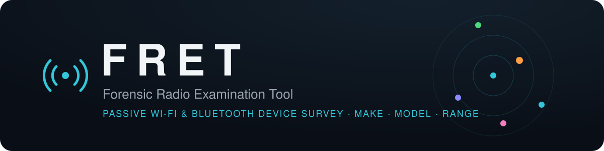
</p>

<p align="center">
  <a href="https://github.com/BlackSandsLabs/FRET/actions/workflows/tests.yml"></a>
  
  
  
  
  
  
</p>

**FRET** is a Windows tool for surveying the Wi-Fi and Bluetooth devices around you. It works with a pocket-sized M5Stack receiver that only listens. Survey from one spot, or walk the area and FRET triangulates where each device is.

For each phone, tablet, computer, CCTV camera, wearable, router or IoT device it hears, FRET shows:

- the **device type**, with the evidence behind it
- the **make**, from the IEEE MAC registry
- the **model**, when the device broadcasts it
- an **approximate distance** from the receiver, as a true-scale ring on a satellite map
- an **approximate position**, distance and compass bearing when you walk the area, with a 95% confidence ellipse

Everything is recorded to a timestamped case log with an audit trail and SHA-256 hashed exports.

<p align="center">
  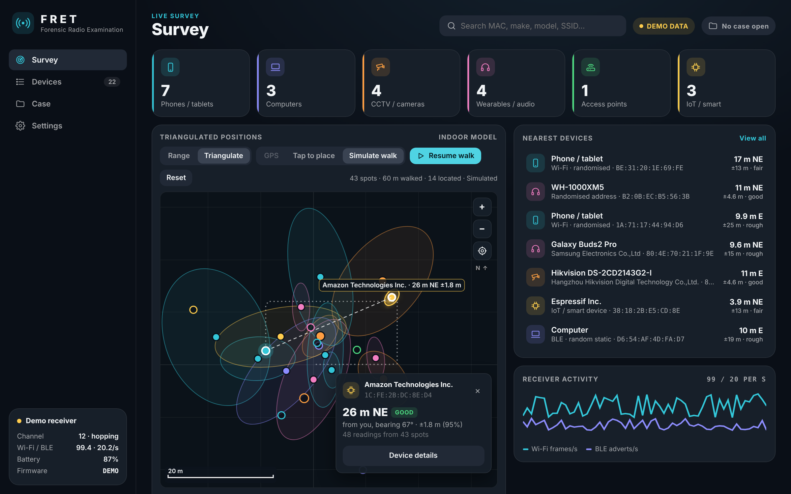
</p>

---

## Contents

- [Features](#features)
- [Screenshots](#screenshots)
- [What you need](#what-you-need)
- [Quick start](#quick-start)
- [Using FRET](#using-fret)
- [How it works](#how-it-works)
- [Accuracy and limitations](#accuracy-and-limitations)
- [Evidence handling](#evidence-handling)
- [Project structure](#project-structure)
- [Documentation](#documentation)
- [Roadmap](#roadmap)
- [Contributing](#contributing)
- [Legal and ethical use](#legal-and-ethical-use)
- [Licence](#licence)
- [Acknowledgements](#acknowledgements)

---

## Features

| | |
|---|---|
| **Device discovery** | Captures Wi-Fi management and data frames on 2.4 GHz channels 1–13, plus Bluetooth LE advertisements |
| **Make identification** | Bundles all 58,000+ IEEE MA-L, MA-M and MA-S assignments; the most specific match wins. Updatable from inside the app |
| **Device type** | Evidence-scored classification into phone/tablet, computer, CCTV/camera, wearable/audio, access point or IoT, with a confidence score and the reasons shown |
| **Model hints** | Decoded from WPS (manufacturer, model name and number, device category), Bluetooth names and appearance, Apple Continuity, Microsoft CDP, Google Fast Pair and ISP router network names |
| **Randomised addresses** | Detected and flagged. Phones are still typed from behaviour and Bluetooth content. Router guest and mesh networks are linked back to their parent router |
| **Linked devices** | Randomised Wi-Fi addresses with an identical probe fingerprint are grouped as *possibly the same device* |
| **Distance** | Log-distance path-loss estimate shown as a likely range (e.g. *3.4 – 14 m*), with environment presets and 1 m calibration |
| **Survey map & triangulation** | True-scale satellite map centred on you. Walk the area (GPS or tap-to-place) and FRET triangulates each device to a point with a 95% confidence ellipse, distance and compass bearing |
| **CCTV focus** | Surveillance manufacturers (Hikvision/EZVIZ, Dahua/Imou, Axis, Uniview, Hanwha, Vivotek and more), camera WPS types and camera-style network names |
| **Case management** | Per-case SQLite log of every observation (UTC), an audit trail of examiner actions, and CSV/JSON/HTML exports hashed into `SHA256SUMS.txt` |
| **Passive by default** | The receiver never connects to anything or transmits Wi-Fi frames. Active Bluetooth scanning, which gets device names, is optional and logged |
| **Modern UI** | Dark desktop interface with a live survey map, filters, search, device detail panel and notes. A demo mode works without hardware |

---

## Screenshots

<table>
<tr>
<td width="50%">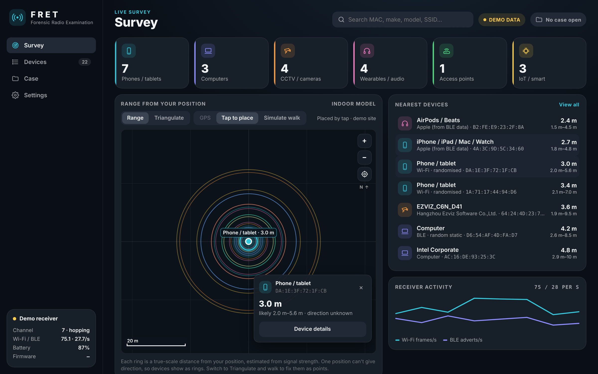<br><sub><b>Range mode</b>: each device is a true-scale ring at its estimated distance from you. One position can't give direction, so devices are rings, not points.</sub></td>
<td width="50%">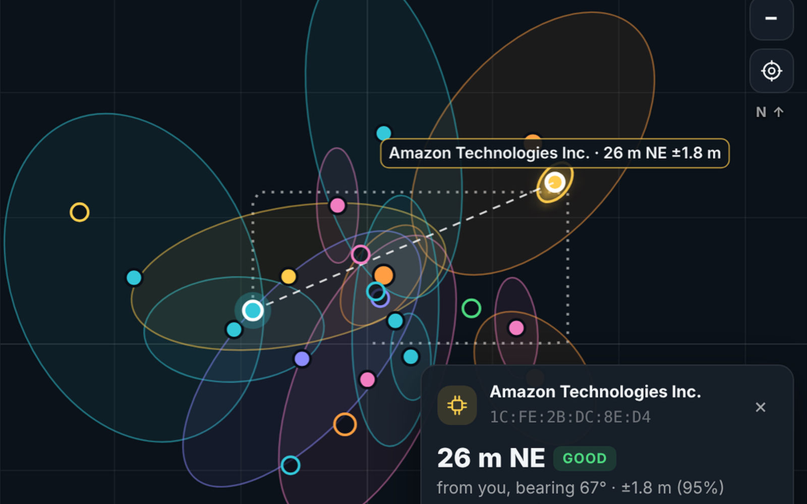<br><sub><b>Triangulate mode</b>: after a walk (dotted track), each device has a position and a 95% confidence ellipse. The selected device shows its distance, bearing and accuracy.</sub></td>
</tr>
<tr>
<td width="50%">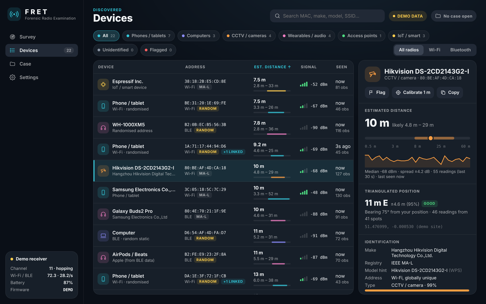<br><sub><b>Devices</b>: a sortable, filterable list with the detail panel. This Hikvision camera was identified from its registered address and its WPS model, and triangulated to 11 m east of the examiner after a walk.</sub></td>
<td width="50%">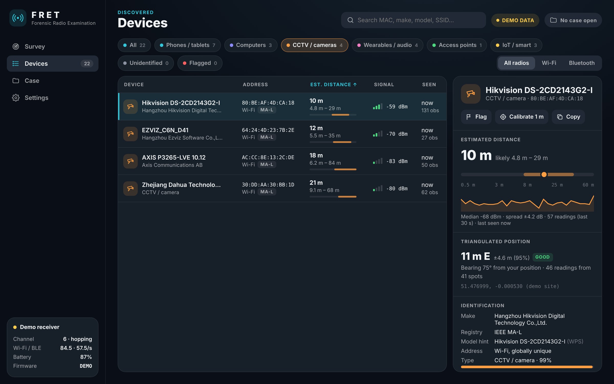<br><sub><b>CCTV filter</b>: one click shows only cameras.</sub></td>
</tr>
<tr>
<td>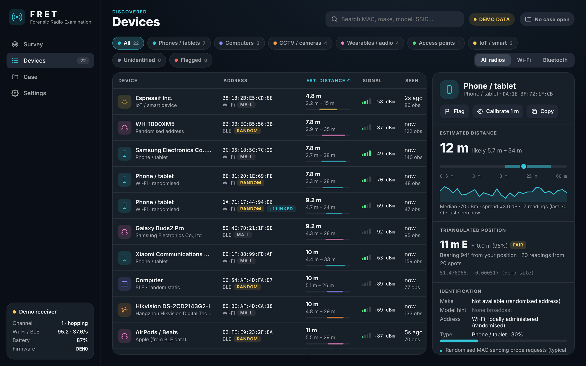<br><sub><b>Randomised phone</b>: typed from its behaviour, and linked to another address with the same fingerprint.</sub></td>
<td>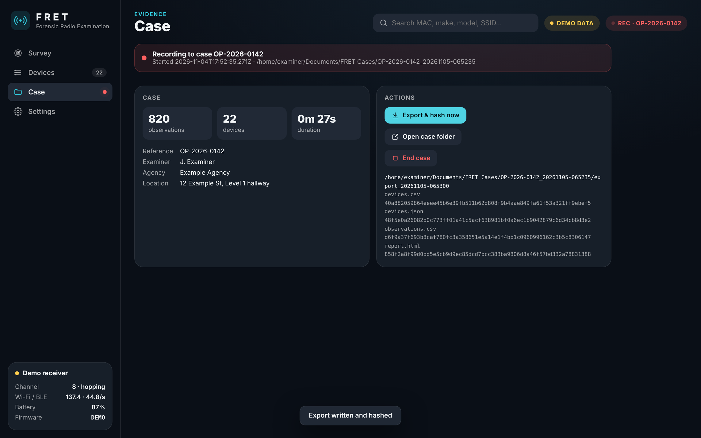<br><sub><b>Case</b>: live logging, export and per-file SHA-256 hashes.</sub></td>
</tr>
<tr>
<td>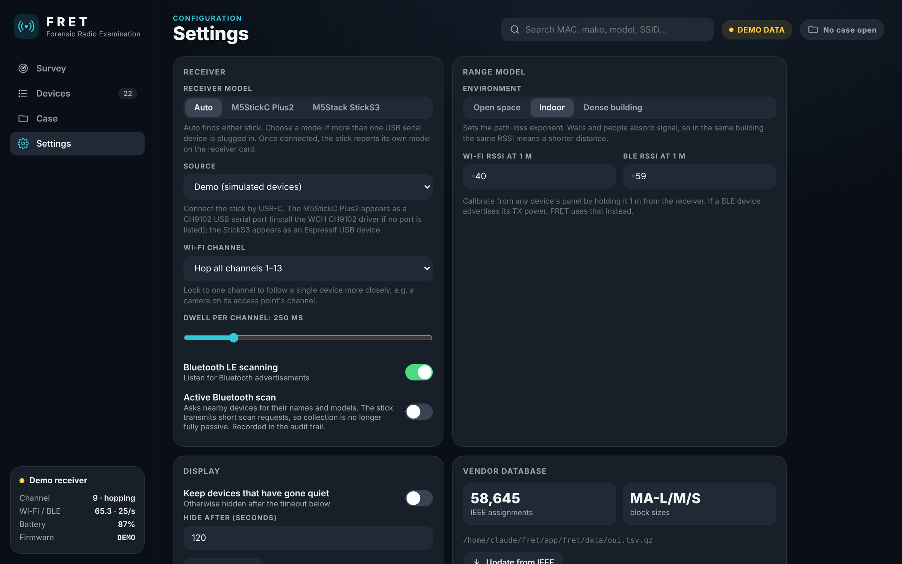<br><sub><b>Settings</b>: receiver, channel lock, active Bluetooth scan, range model and vendor database.</sub></td>
<td>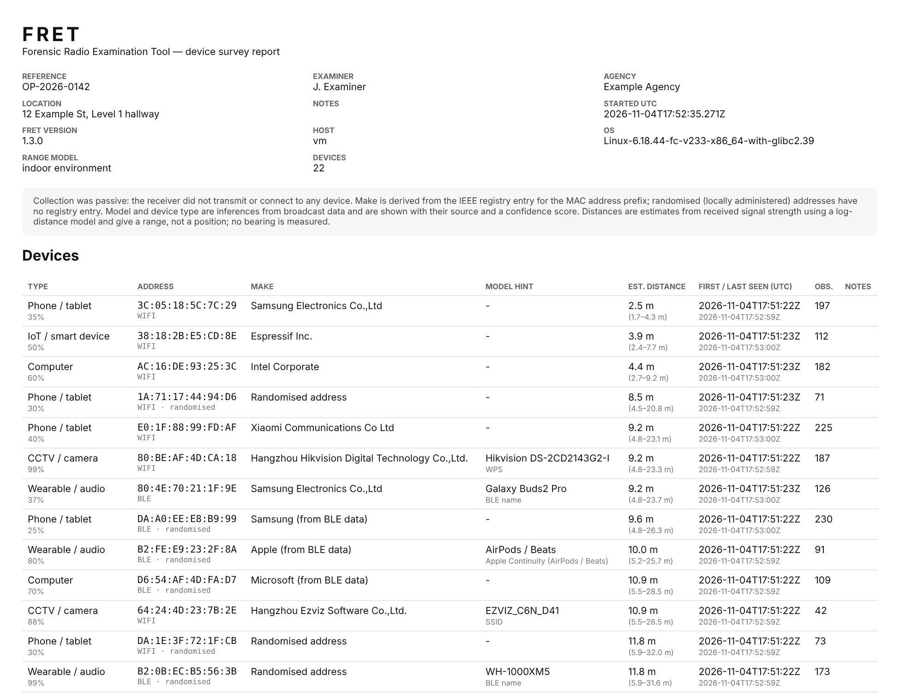<br><sub><b>Report</b>: the exported HTML report with case details, devices and audit trail.</sub></td>
</tr>
</table>

> Screenshots use FRET's built-in **demo mode**, so all MAC addresses and devices shown are simulated. The map shows its offline grid; with an internet connection, satellite imagery is drawn underneath at the same scale.

---

## What you need

| Item | Notes |
|---|---|
| **Windows 10 or 11 PC** | Uses Microsoft Edge WebView2, which is built in |
| **Python 3.10 or later** | From [python.org](https://www.python.org/downloads/). Tick **Add python.exe to PATH** when installing |
| **Receiver** | [M5StickC Plus2](https://docs.m5stack.com/en/core/M5StickC%20PLUS2) (ESP32) **or** [M5Stack StickS3](https://docs.m5stack.com/en/core/StickS3) (ESP32-S3) |
| **USB-C data cable** | Some cables only charge, and those won't work |
| **For the survey map (optional)** | An internet connection for satellite imagery. For triangulation, Windows location (a USB GPS receiver helps outdoors) or tap-to-place on the map |

No other software is needed: the flashing script installs PlatformIO itself. An RTL-SDR is **not** used; see [docs/HARDWARE.md](docs/HARDWARE.md#why-not-an-rtl-sdr).

---

## Quick start

```text
1. Download   →  Code ▸ Download ZIP (or git clone), unzip anywhere, e.g. Documents\FRET
2. Install    →  double-click  app\setup_windows.bat        (one time, ~1 min)
3. Try it     →  double-click  app\FRET_demo.bat            (no hardware needed)
4. Flash      →  plug in the stick, double-click firmware\flash_stick.bat
                 choose 1 = M5StickC Plus2 or 2 = StickS3   (first run ~5–10 min)
5. Survey     →  double-click  app\FRET.bat                 (finds the stick automatically)
```

Step-by-step instructions with screenshots and troubleshooting are in **[docs/INSTALL.md](docs/INSTALL.md)**.

---

## Using FRET

| View | Use it to |
|---|---|
| **Survey** | See device counts by type, true-scale range rings on a satellite map, walk-to-triangulate device positions, the nearest devices and receiver activity |
| **Devices** | Search, filter by type or radio, and sort by distance, signal or last seen. Select a device to see its distance band, signal history, identification evidence, broadcast details, linked addresses, and to add notes or flags |
| **Case** | Open a case (reference, examiner, agency, location, notes), log everything, export and hash, and end the case |
| **Settings** | Choose the receiver or demo, lock a channel, set the dwell time, switch Bluetooth and active scan on or off, pick the range model, set calibration and update the vendor database |

### A typical survey

1. Place the receiver at the point of interest. Note the position in the case **Location** field. The Survey map centres on your location; if Windows can't provide one, choose **Tap to place** and tap where you are.
2. In **Settings**, pick the **Environment**: *Open space*, *Indoor* or *Dense building*.
3. Optionally, **calibrate**: hold a phone 1 m from the stick, open it in **Devices** and press **Calibrate 1 m**.
4. In **Case**, enter a reference and press **Start logging**.
5. Let it run. Most devices show up within 1–5 minutes, but idle devices may stay silent longer.
6. To locate devices, switch the Survey map to **Triangulate** and press **Start walk**. Walk a loop or an L-shape across the area, a few metres at a time. With **Tap to place**, tap your new spot each time you stop. Devices appear as points with 95% confidence ellipses as readings build up.
7. Review **Devices**. Flag items of interest and add notes, which are saved to the audit trail.
8. Press **Export & hash now**, or **End case** to write a final export.

The full walkthrough is in **[docs/USER_GUIDE.md](docs/USER_GUIDE.md)**.

### On-stick controls

| Button | Action |
|---|---|
| Front (M5) | Lock or unlock the current Wi-Fi channel |
| Side | Dim the screen |

The stick's screen shows live Wi-Fi and BLE device counts, the nearest device, the channel, the battery level and the PC link status.

---

## How it works

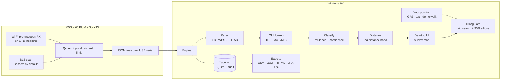

- **Make.** The first 24, 28 or 36 bits of a globally unique MAC address are looked up in the IEEE registry.
- **Randomised addresses.** A MAC is randomised when its *locally administered* bit is set. Bluetooth random addresses are identified by their address type. These addresses have no registry entry. FRET labels them, then:
  - uses the Bluetooth company ID ("Apple (from BLE data)")
  - for router guest and mesh networks, links the address to the router's registered address
- **Device type.** Each piece of evidence adds weight to a category, and the strongest category wins. The reasons are listed in the device panel. Evidence includes:
  - vendor
  - beacons
  - probe behaviour
  - WPS device category and model
  - Bluetooth appearance, name and company ID
  - Apple Continuity type
  - Microsoft CDP
  - Fast Pair
  - network name
- **Distance.** FRET takes the median RSSI over the last 30 s and applies `d = 10^((RSSI₁ₘ − RSSI) / (10·n))`. It gives a min–max band using the environment's range of path-loss exponents `n` and the measured RSSI spread. When a BLE device advertises its TX power, FRET uses that instead of the default.

- **Position (Triangulate mode).** As you walk, FRET pairs each device's RSSI with your position, keeping the median reading for every 1.5 m spot. For each candidate point on a 64 × 64 grid around the walk, it fits the 1 m reference level in closed form (with the calibrated value as a soft ±10 dB prior) and scores how well the log-distance model explains every spot. The best point is the estimate, and the spread of the likelihood around it gives the 95% ellipse. A device needs readings from at least 4 spots spread over 3 m or more. Fits are rated *good* (±6 m or better), *fair* (±15 m) or *rough*.
- **Map.** Web Mercator tiles from Esri World Imagery, drawn in a local metric frame centred where the walk started, so rings and ellipses are true to scale.

More detail is in **[docs/HOW_IT_WORKS.md](docs/HOW_IT_WORKS.md)**.

---

## Accuracy and limitations

- **2.4 GHz only.** Devices that are only on 5 or 6 GHz won't appear.
- **Randomised MACs.** Since iOS 14 and Android 10, phones use random Wi-Fi and Bluetooth addresses, so they have **no make from the registry**. FRET still types them, and often names the brand from Bluetooth data. Exact phone models are usually not broadcast.
- **Distance is a range, not a position.** Walls, bodies and antenna orientation can each shift readings by 5–10 dB. One position cannot give direction. Triangulate mode gets direction by walking, and its accuracy depends on how much ground you cover and in how many directions.
- **Triangulation needs geometry.** Walking in a straight line can't tell which side of the line a device is on; the ellipse stretches to show it. Cover two directions. Shadowing from walls and bodies varies from spot to spot, so real ellipses are larger than in the demo.
- **Laptop location is coarse.** Without a GPS receiver, Windows usually locates a laptop from nearby Wi-Fi, to tens of metres. FRET skips triangulation samples worse than ±30 m. Indoors, use **Tap to place**.
- **Channel hopping.** Very short bursts on another channel can be missed. Lock a channel to watch one network closely.
- **Quiet devices.** Idle devices may transmit rarely and may not appear at all during a short survey.
- **Linked addresses are leads, not proof.** Matching probe fingerprints suggest the same handset, but many devices of one model share a fingerprint.

---

## Evidence handling

Each case gets its own folder:

```text
Documents\FRET Cases\OP-2026-0142_20261102-195549\
├── case.db                     ← every observation (UTC), case info, audit trail
└── export_20261102-200314\
    ├── devices.csv
    ├── devices.json
    ├── observations.csv        ← raw log
    ├── report.html
    └── SHA256SUMS.txt          ← hashes, also written to the audit trail
```

- **Audit trail.** Every examiner action is logged: settings, channel locks, calibration, notes, flags, source changes and exports.
- **Map imagery reveals the survey area.** Satellite tiles are downloaded from Esri while the map is open, so Esri's servers see which area is being viewed. Work offline if that matters for the case; the map falls back to a metric grid. Triangulated positions are shown in the app and are not yet written to the case log or exports.
- **No content.** Only frame headers and management-frame tags (SSIDs, capabilities, WPS identity) are kept. Data-frame payloads are never captured.

Details are in **[docs/EVIDENCE.md](docs/EVIDENCE.md)**.

---

## Project structure

```text
FRET/
├── app/                      Windows application (Python)
│   ├── fret/
│   │   ├── sources.py        serial receiver + demo simulator
│   │   ├── parse.py          802.11 IEs, WPS, BLE AD structures
│   │   ├── oui.py            IEEE vendor database (bundled + updater)
│   │   ├── classify.py       evidence-scored device typing
│   │   ├── distance.py       RSSI → distance band, calibration
│   │   ├── tracker.py        per-device state, linking
│   │   ├── case.py           SQLite case log, exports, report
│   │   ├── engine.py         ties it together; UI API
│   │   ├── ui/               HTML/CSS/JS interface, survey map, triangulation solver
│   │   └── data/oui.tsv.gz   58k IEEE assignments
│   ├── setup_windows.bat     one-time install
│   ├── FRET.bat              launch (live)
│   ├── FRET_demo.bat         launch (demo)
│   └── build_exe.bat         optional standalone FRET.exe
├── firmware/                 receiver firmware (PlatformIO)
│   ├── src/main.cpp
│   ├── platformio.ini        envs: m5stickc-plus2, m5stack-sticks3
│   ├── flash_stick.bat       build + flash, no IDE needed
│   └── capture_log.bat       record boot log for troubleshooting
├── tools/                    vendor DB builder, preview builder
├── tests/                    unit tests
└── docs/                     guides and screenshots
```

---

## Documentation

| Guide | |
|---|---|
| [Installation](docs/INSTALL.md) | Python, setup, flashing the stick, first run |
| [User guide](docs/USER_GUIDE.md) | Every screen and setting, survey map, triangulation, calibration |
| [Hardware](docs/HARDWARE.md) | Supported receivers, buttons, why not RTL-SDR |
| [How it works](docs/HOW_IT_WORKS.md) | Identification, classification and distance in depth |
| [Evidence handling](docs/EVIDENCE.md) | Case files, audit trail, hashing, verification |
| [Troubleshooting](docs/TROUBLESHOOTING.md) | Common problems and fixes |
| [Serial protocol](docs/PROTOCOL.md) | Stick ↔ PC message format and commands |
| [Changelog](CHANGELOG.md) | Release history |

---

## Roadmap

- [ ] Multi-receiver mode: two or three sticks for rough position (trilateration)
- [ ] 5 GHz support via an ESP32-C5 receiver
- [ ] Optional RTL-SDR module for 433/868/915 MHz IoT sensors
- [ ] Watch-list alerts for specific MACs, vendors or SSIDs
- [x] Walk-and-triangulate mode: pair RSSI with position to locate each device (1.3.0)
- [ ] Record walk tracks and triangulated positions in the case log and report
- [ ] Phone step-counter positioning for indoor walks without tapping
- [ ] Signed standalone installer

---

## Contributing

Bug reports and improvements are welcome. See **[CONTRIBUTING.md](CONTRIBUTING.md)** for development setup, tests and style. To report a security issue, see **[SECURITY.md](SECURITY.md)**.

```bash
python -m unittest discover -s tests      # run the test suite
python -m fret --demo --browser           # run the UI in your browser (from app/)
```

---

## Legal and ethical use

FRET is intended for lawful forensic, security-assessment and research work.

- Passive collection of radio identifiers may still be regulated where you operate. Make sure you have the appropriate authority before conducting surveys.
- Treat collected identifiers as personal data where applicable.
- Active Bluetooth scanning transmits requests, so use it only where that is permitted.

The authors accept no liability for misuse.

---

## Licence

Copyright © 2026 Black Sands Labs.

FRET is free software, released under the **[GNU General Public License v3.0](LICENSE)**:

- You may use, study, share and modify it.
- If you distribute it or a modified version, you must do so under the same licence and make the source available.
- It comes with **no warranty**.

The bundled vendor data is derived from the IEEE public registries as compiled in Wireshark's `manuf` data (GPL-2.0-or-later, compatible with GPL-3.0). To produce a copy straight from the IEEE CSV files, run `tools/build_oui.py --ieee`, or use **Settings → Update from IEEE**.

---

## Acknowledgements

- [IEEE Registration Authority](https://standards.ieee.org/products-programs/regauth/): OUI / MA-L / MA-M / MA-S registries
- [Wireshark](https://www.wireshark.org/): compiled `manuf` vendor data
- [M5Stack](https://m5stack.com/) and [M5Unified](https://github.com/m5stack/M5Unified): hardware and board support
- [NimBLE-Arduino](https://github.com/h2zero/NimBLE-Arduino): Bluetooth LE stack
- [pywebview](https://pywebview.flowrl.com/) and [pyserial](https://github.com/pyserial/pyserial)
