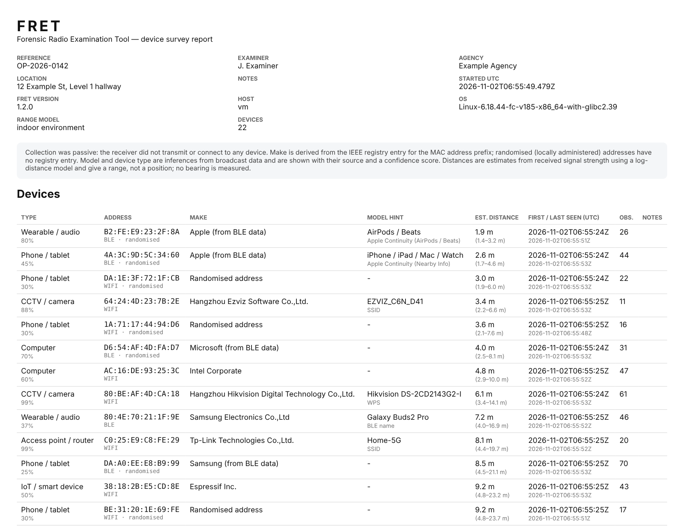

# Evidence handling

## Principles

- **Passive by default.** The receiver never associates with a network, never transmits Wi-Fi frames, and scans Bluetooth passively. The optional active Bluetooth scan is the only thing that transmits. Turning it on or off is logged, and the report says which mode was used.
- **No content.** Only headers, addresses, signal metadata and management-frame tags are recorded. Data-frame payloads are never read or stored.
- **Everything is recorded, and nothing is overwritten.** The raw observation log is append-only during a case. Clearing the screen does not touch it.
- **Every action is attributable.** Settings, commands, notes, flags, calibration and exports are logged with UTC time.

## Case folder

```text
Documents\FRET Cases\<reference>_<YYYYMMDD-HHMMSS>\
├── case.db
└── export_<YYYYMMDD-HHMMSS>\
    ├── devices.csv
    ├── devices.json
    ├── observations.csv
    ├── report.html
    └── SHA256SUMS.txt
```

### case.db (SQLite)

| Table | Contents |
|---|---|
| `case_info` | Reference, examiner, agency, location, notes, start and end time (UTC), FRET version, host name, OS |
| `observations` | One row per forwarded frame or advert: `ts_utc`, `medium`, `mac`, `kind`, `rssi`, `channel`, `bssid`, `raw_hex` |
| `audit` | `ts_utc`, `action`, `detail` |

Audit actions:

| Action | Recorded when |
|---|---|
| `case_opened`, `case_closed` | A case starts or ends |
| `receiver` | Receiver identity and firmware, at case start |
| `settings` | Full settings snapshot, at case start |
| `setting` | A setting changes |
| `receiver_command` | A channel lock, dwell change, BLE on/off or active-scan change is sent |
| `source_changed` | The source changes |
| `calibrate` | Calibration runs |
| `annotate` | A note or flag is added |
| `clear_view` | The device list is cleared |
| `oui_update` | The vendor database is updated |
| `export` | An export is written, including its file hashes |

You can open `case.db` with any SQLite viewer, such as *DB Browser for SQLite*.

### Exports

| File | Contents |
|---|---|
| `devices.csv` | One row per device: identification, confidence, model and source, distance estimate and range, first/last seen (UTC), channels, SSIDs, linked addresses, flag, note |
| `devices.json` | The same as `devices.csv` plus every evidence reason, decoded WPS and BLE fields, case info and the settings in force |
| `observations.csv` | The complete raw log from `case.db` |
| `report.html` | A human-readable report: case details, a methodology note, the device table and the full audit trail. Opens in any browser and prints to PDF |
| `SHA256SUMS.txt` | The SHA-256 of each file above, in standard `sha256sum` format |



## Verifying hashes

**PowerShell:**

```powershell
cd "Documents\FRET Cases\OP-2026-0142_...\export_..."
Get-FileHash -Algorithm SHA256 devices.csv, devices.json, observations.csv, report.html
```

**Command Prompt:**

```bat
certutil -hashfile report.html SHA256
```

**Linux / macOS / WSL:**

```bash
sha256sum -c SHA256SUMS.txt
```

The same hashes are recorded in the `audit` table of `case.db` (action `export`), so an export can be checked against the log that produced it.

## Recommended practice

1. Record the receiver's position (photograph it) and enter it in **Location**.
2. Note in the case **Notes** whether active Bluetooth scanning is permitted.
3. Export, then **End case** to write the final export and the `ended_utc` entry.
4. Copy the entire case folder to write-once or controlled evidence storage, and verify the hashes after copying.
5. In reports, treat:
   - **makes** as registry facts
   - **types and models** as inferences, citing the listed reasons and source
   - **distances** as estimated ranges, citing the environment model and whether calibration was done
