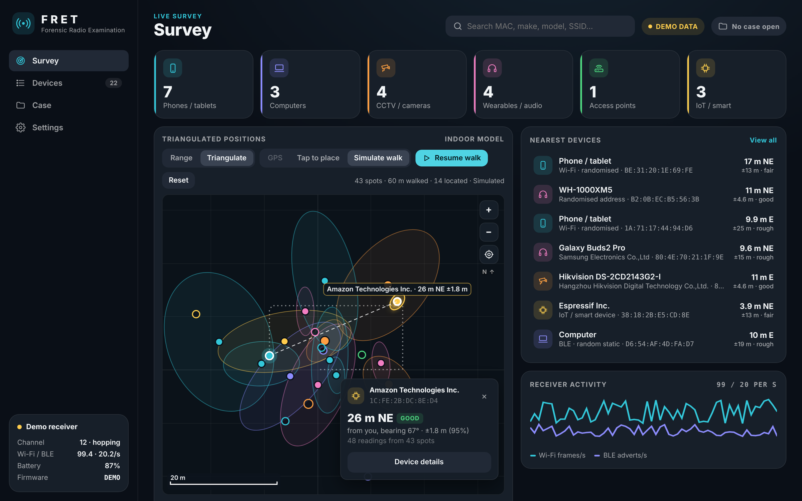

# Installation

This guide takes you from a fresh Windows PC to a live survey. It takes about 15 minutes, most of it spent waiting for the first firmware build.

- [1. Install Python](#1-install-python)
- [2. Get FRET](#2-get-fret)
- [3. Install the app](#3-install-the-app)
- [4. Try the demo](#4-try-the-demo)
- [5. Flash the receiver](#5-flash-the-receiver)
- [6. First live survey](#6-first-live-survey)
- [Optional: build a standalone FRET.exe](#optional-build-a-standalone-fretexe)
- [Updating](#updating)
- [Uninstalling](#uninstalling)

---

## 1. Install Python

1. Download **Python 3.10 or newer** (64-bit) from <https://www.python.org/downloads/windows/>.
2. Run the installer. On the first screen, **tick "Add python.exe to PATH"**, then click **Install Now**.
3. To check it worked, open *Command Prompt* and run:

   ```bat
   py --version
   ```

   It should print `Python 3.x.y`.

> FRET's window uses **Microsoft Edge WebView2**, which ships with Windows 10 (21H2+) and Windows 11. On older builds, install the *Evergreen Runtime* from Microsoft.

## 2. Get FRET

Pick one:

- **ZIP:** on the GitHub page, click **Code ▸ Download ZIP**. Unzip it somewhere permanent, such as `Documents\FRET`.
- **Git:**

  ```bat
  git clone https://github.com/BlackSandsLabs/FRET.git
  ```

Avoid putting it in a folder that syncs constantly (some OneDrive setups) while capturing, because the case database is written every second.

## 3. Install the app

Double-click **`app\setup_windows.bat`**.

It does three things:

1. Creates a private Python environment in `app\.venv`, so nothing is installed system-wide.
2. Installs `pywebview` (the app window) and `pyserial` (the USB link to the stick).
3. Prints **Setup complete** when it's finished.

You only need to do this once.

## 4. Try the demo

Double-click **`app\FRET_demo.bat`**.

FRET opens with about 22 simulated devices: cameras, phones, laptops, earbuds and a router. A yellow **DEMO DATA** badge shows in the top bar. Use the demo to get to know the screens before using real hardware; see the [User guide](USER_GUIDE.md).



## 5. Flash the receiver

The receiver needs FRET's firmware, and you only flash it once. No IDE is needed.

1. Plug the stick into the PC with a **USB-C data cable**.
2. Close FRET if it's open, because it holds the serial port.
3. Double-click **`firmware\flash_stick.bat`**.
4. Answer the prompts:

   | Prompt | Answer |
   |---|---|
   | *Which stick is connected?* | `1` = **M5StickC Plus2**, `2` = **M5Stack StickS3**. The model is printed on the back of the stick |
   | *COM port* | The port listed for the stick (e.g. `COM5`), or press **Enter** to auto-detect |

5. Wait.
   - The first run installs PlatformIO and downloads the ESP32 toolchain, which takes **5–10 minutes**. Later runs take under a minute.
   - When it finishes it prints **Done** and the stick's screen shows **FRET** with live counts.

If it prints **FAILED**, see [Troubleshooting → Flashing](TROUBLESHOOTING.md#flashing).

> **Unplug other ESP32 gadgets** before flashing. The uploader refuses a board with the wrong chip, but it will flash any matching board on the port you give it.

## 6. First live survey

1. Leave the stick plugged in.
2. Double-click **`app\FRET.bat`**.
3. The receiver card in the bottom-left turns green and shows the channel and frame rates. The top bar shows **LIVE**.
4. Devices start appearing within seconds.

Next, read the [User guide](USER_GUIDE.md#a-complete-survey) for the full survey workflow, including opening a case.

---

## Optional: build a standalone FRET.exe

To run FRET on a PC without installing Python:

1. Run `app\setup_windows.bat` once on a build PC.
2. Double-click **`app\build_exe.bat`**.
3. Copy the whole **`app\dist\FRET`** folder to the target PC and run **`FRET.exe`**.

## Updating

1. Replace the FRET folder with the new version. Your cases live in `Documents\FRET Cases` and are not touched.
2. Run `app\setup_windows.bat` again if `requirements.txt` changed.
3. Run `firmware\flash_stick.bat` again if the release notes mention firmware changes.

The vendor database can be refreshed separately: in FRET, go to **Settings → Vendor database → Update from IEEE**.

## Uninstalling

Delete the FRET folder. Settings and the downloaded vendor database are kept in `%APPDATA%\FRET`; delete that too if you want. Case folders in `Documents\FRET Cases` are **not** removed automatically.
