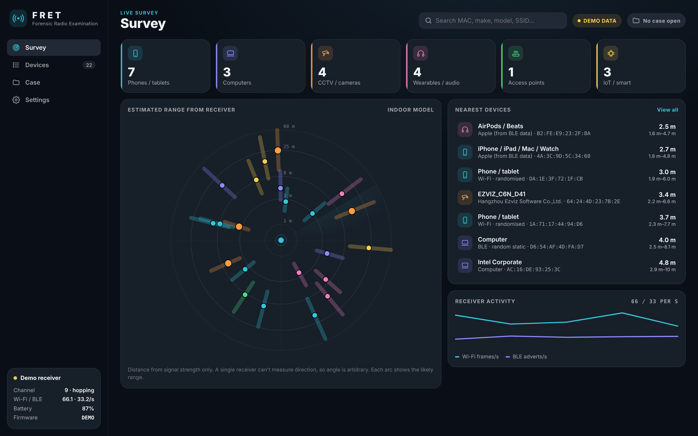
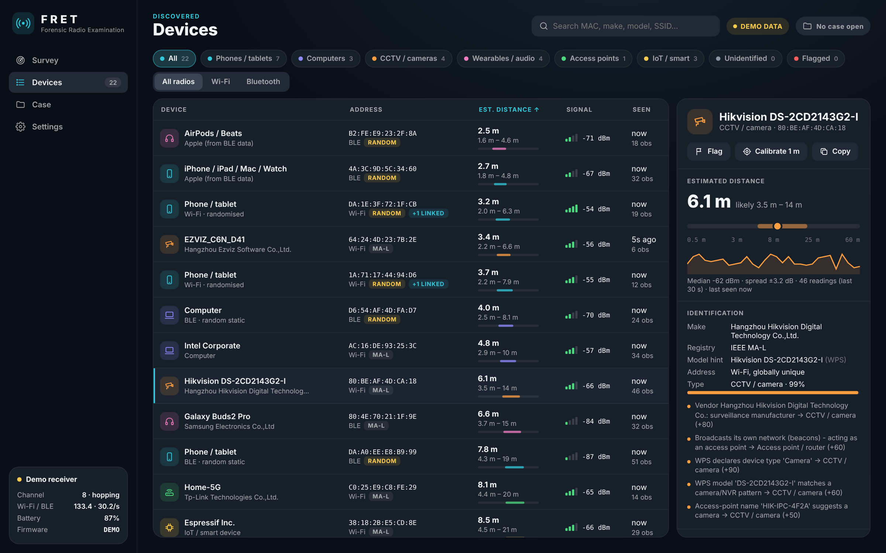
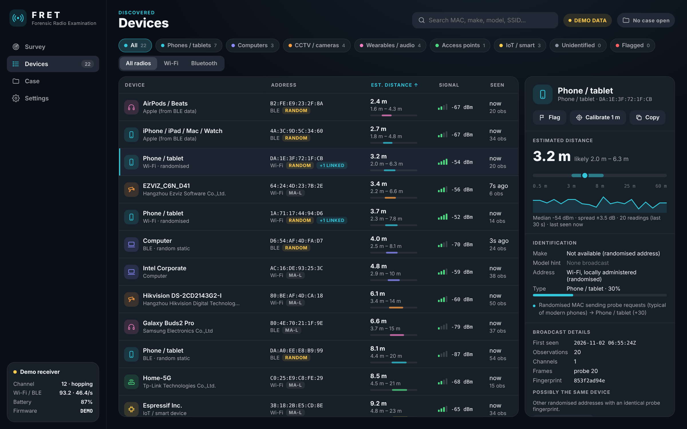
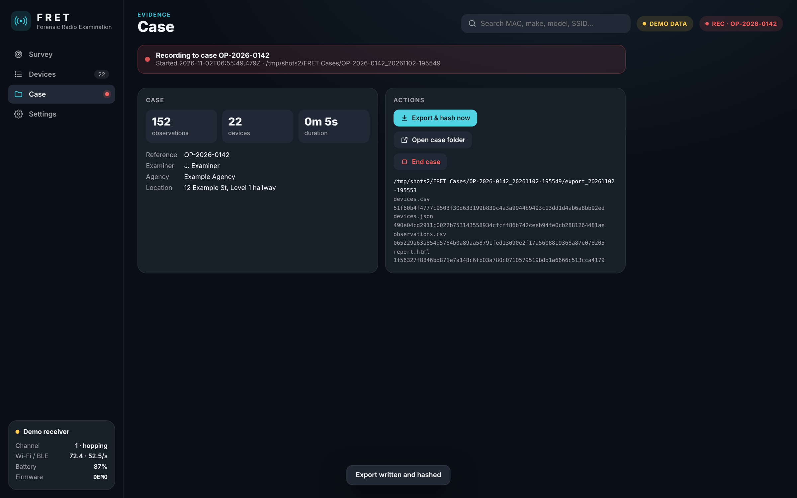
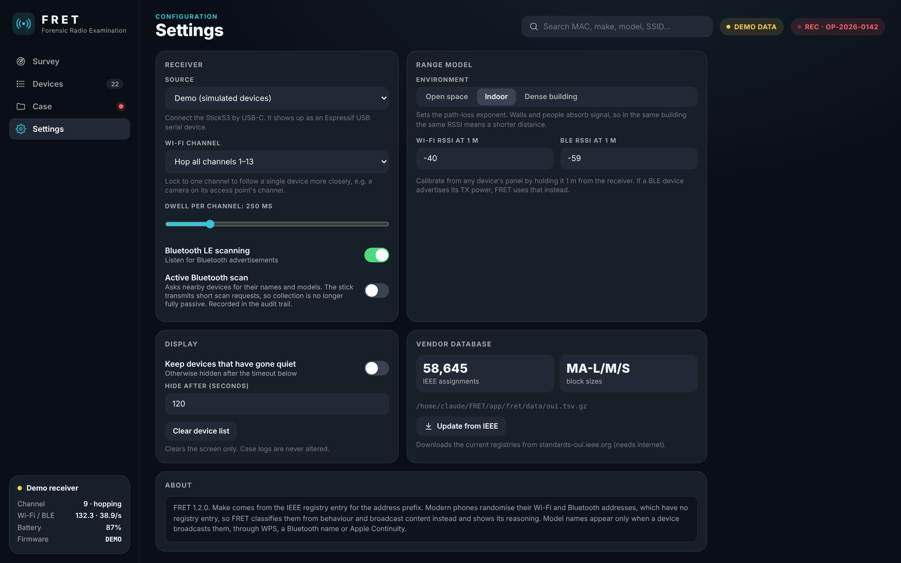

# User guide

- [The interface](#the-interface)
- [Survey](#survey)
- [Devices](#devices)
- [Device detail panel](#device-detail-panel)
- [Case](#case)
- [Settings](#settings)
- [Calibrating distance](#calibrating-distance)
- [A complete survey](#a-complete-survey)
- [Tips for better results](#tips-for-better-results)
- [Keyboard and search](#keyboard-and-search)

---

## The interface

| Area | What it shows |
|---|---|
| **Sidebar** | Navigation (Survey, Devices, Case, Settings) and the **receiver card**: connection, channel, frame rates, battery and firmware |
| **Top bar** | Global search, source badge (**LIVE**, **DEMO DATA** or **NO RECEIVER**) and case badge (**REC · reference** when logging) |

The receiver card's dot is green when the stick is connected, yellow in demo mode and red when no stick is found.

---

## Survey

- **Category tiles.** Counts of phones/tablets, computers, CCTV/cameras, wearables/audio, access points and IoT. Click a tile to open **Devices** filtered to that type.
- **Range radar.**
  - Each dot is a device, placed by **estimated distance** on a logarithmic scale (1, 3, 8, 25, 60 m rings).
  - The coloured bar through each dot is the **likely range**.
  - Faded dots haven't been heard for over 10 seconds. Camera dots are drawn slightly larger.
  - **Angle is arbitrary.** One receiver can't measure direction, so each device's angle is fixed from its MAC address only to keep the layout stable.
  - Hover a dot for details, or click it to open the device.
- **Nearest devices.** The seven closest devices by estimate.
- **Receiver activity.** Wi-Fi frames per second and BLE adverts per second.

---

## Devices

### Filters

- **Category chips:** All, each device type, Unidentified and **Flagged**.
- **Radio switch:** All radios, Wi-Fi or Bluetooth.
- **Search:** top bar. It matches MAC, make, model, SSID, probed networks, Bluetooth name and notes.

### Columns

Click a column header to sort, and click again to reverse.

| Column | Meaning |
|---|---|
| **Device** | Model hint if one was broadcast, otherwise the make or device type. The icon colour shows the category |
| **Address** | MAC, radio, and a tag: `MA-L`/`MA-M`/`MA-S` (registered), `RANDOM` (randomised), `+N LINKED` (possible same device) |
| **Est. distance** | Best estimate, likely range, and a bar on the same log scale as the radar |
| **Signal** | Last RSSI in dBm with signal bars |
| **Seen** | Time since last heard, and the number of observations |

Rows that haven't been heard for 30 seconds fade. Devices silent for longer than **Settings → Hide after** are hidden unless **Keep devices that have gone quiet** is on.

---

## Device detail panel

Select any row to open the panel.

| Section | Contents |
|---|---|
| **Header** | Device name, type, MAC. Buttons: **Flag**, **Calibrate 1 m**, **Copy** (MAC) |
| **Estimated distance** | Big estimate, likely range on a scale bar, RSSI history graph, median, spread and number of readings |
| **Identification** | Make and registry block, model hint with its source, address type, and type with confidence. Then the **reasons**: each piece of evidence and the weight it added |
| **Broadcast details** | First seen (UTC), observations, channels, frame types, the network it broadcasts, the network it's connected to, WPS fields, Bluetooth name, company, Apple type, services, TX power, probe fingerprint |
| **Networks searched for** | SSIDs the device asked for in probe requests. These are often home or work networks |
| **Possibly the same device** | Other randomised addresses with an identical probe fingerprint |
| **Examiner note** | Free text. It saves automatically and is written to the case audit trail |

---

## Case

### Opening a case

Fill in:

- **Reference** (required)
- Examiner, Agency and Location (optional)
- Notes (optional)

Then press **Start logging**. Examiner and agency are remembered for next time.

### While recording

- The **REC** badge shows in the top bar, and a red dot shows on **Case** in the sidebar.
- Every frame and advert the receiver forwards is written to the case database with a UTC timestamp.
- **Export & hash now** writes a complete export at any point. Hashes appear under the button.
- **Open case folder** opens it in Explorer.
- **End case** writes a final export, closes the log and records the end time. Capture continues on screen.

See [Evidence handling](EVIDENCE.md) for the folder layout and how to verify hashes.

---

## Settings

### Receiver

| Setting | Notes |
|---|---|
| **Source** | Auto-detect, a specific COM port, or Demo |
| **Wi-Fi channel** | *Hop all channels 1–13* (default) or lock to one channel. Lock to a camera's or router's channel to catch more of its traffic |
| **Dwell per channel** | 100–1000 ms (default 250). Longer catches more from busy channels but sweeps more slowly |
| **Bluetooth LE scanning** | On or off |
| **Active Bluetooth scan** | Off by default. When on, the stick sends scan requests, so devices reply with their **names and models** (e.g. *Galaxy Buds2 Pro*, *[TV] Samsung 7 Series*). Collection is then no longer fully passive; this is recorded in the audit trail and the report |

### Range model

| Setting | Notes |
|---|---|
| **Environment** | *Open space* (n ≈ 1.8–2.7), *Indoor* (2.2–3.5), *Dense building* (2.8–4.5) |
| **Wi-Fi / BLE RSSI at 1 m** | Reference levels. Defaults are −40 dBm (Wi-Fi) and −59 dBm (BLE). Set automatically by calibration |

### Display

| Setting | Notes |
|---|---|
| **Keep devices that have gone quiet** | Shows devices beyond the timeout |
| **Hide after (seconds)** | Default 120 |
| **Clear device list** | Clears the screen only. Case logs are never altered |

### Vendor database

Shows the number of IEEE assignments and the file in use. **Update from IEEE** downloads the latest registries from the IEEE (needs internet) and stores them in `%APPDATA%\FRET`.

---

## Calibrating distance

Distances are much better after a quick calibration in the environment you're surveying:

1. Hold a phone (Wi-Fi) or a Bluetooth device **1 m** from the stick, with a clear line of sight, for 10–15 seconds.
2. Find it in **Devices**. The nearest-device list on **Survey** helps.
3. Press **Calibrate 1 m** and confirm.

This sets the reference for that radio (Wi-Fi or BLE) and applies it to all devices. The value is saved and recorded in the audit trail.

---

## A complete survey

1. **Prepare.**
   - Charge the stick. On USB power it runs indefinitely.
   - Note the receiver position.
   - Decide whether active Bluetooth scanning is permitted.
2. **Configure.** Set the Environment, and calibrate if you can.
3. **Open a case.** Enter the reference, examiner and location.
4. **Capture.**
   - Leave it running for **at least 5 minutes**. Longer catches devices that wake up only occasionally.
   - Keep the stick still. Moving it changes every distance.
5. **Review.**
   - Use the CCTV filter and the Flagged filter.
   - Read the reasons for any device you'll rely on.
   - Add notes.
6. **Narrow down** (optional). Lock the channel of a device of interest to collect more of its frames.
7. **Export.** **Export & hash now**, then **End case**.
8. **Preserve.** Copy the case folder to evidence storage and verify the hashes.

---

## Tips for better results

- **Height and placement.** Put the stick at roughly chest height, away from metal surfaces and the PC.
- **Cameras in AP mode.** Many cameras broadcast their own setup network with WPS, which reveals their exact model. Lock to that channel.
- **Phones.** Most phones send probe requests only every 30–90 seconds when the screen is off. Waking a phone, or Wi-Fi scanning on it, makes it appear quickly.
- **Comparing distances.** Distances are most useful *relatively*: in the same session, a device at *2 m* is genuinely closer than one at *15 m*.
- **Two positions.** Take two surveys from different positions; the overlap of the ranges narrows down location.

---

## Keyboard and search

- Typing in the **search** box on the Survey view jumps to Devices, filtered as you type.
- Search accepts partial MACs (`80:BE`), vendors (`hikvision`), models (`DS-2CD`), SSIDs and note text.
